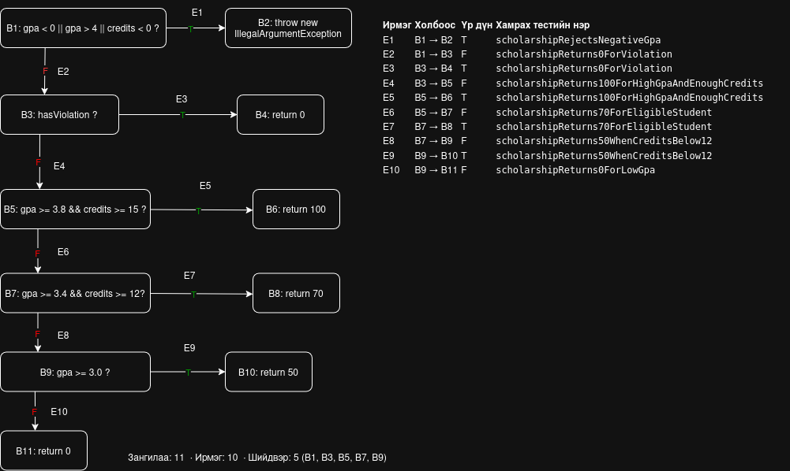

Гарчиг: Лаборатори №9 — Код хамралт ба JaCoCo

- Хичээл: F.CSA313 — Программ хангамжийн чанарын баталгаа ба тест
- Оюутан: Л. Ирмүүн
- Оюутны код: B232270021
- Үйлдлийн систем: Ubuntu Linux
- IDE: Visual Studio Code

А=== java -version ===
openjdk version "21.0.12.1" 2026-08-18
OpenJDK Runtime Environment (build 21.0.12.1+1-1-24.04.4-Ubuntu)
OpenJDK 64-Bit Server VM (build 21.0.12.1+1-1-24.04.4-Ubuntu, mixed mode, sharing)

=== mvn -version ===
Apache Maven 3.8.7
Maven home: /usr/share/maven
Java version: 21.0.12.1, vendor: Ubuntu, runtime: /usr/lib/jvm/java-21-openjdk-amd64
Default locale: en_US, platform encoding: UTF-8
OS name: "linux", version: "7.0.0-42-generic", arch: "amd64", family: "unix"

=== locale charmap ===
UTF-8

## Хэсэг A — Хэвийн урсгал ба анхны хамралт

Хэвийн оролтын 5 тестүүдийг `mvn verify` командаар ажиллуулахад
бүгд амжилттай давж, Maven exit code 0 гарсан.

| Хэмжүүр | Хамрагдсан | Хамрагдаагүй | Хамралт |
|---|---:|---:|---:|
| Line | 17 | 8 | 68.00% |
| Branch | 24 | 17 | 58.54% |

Line хамралт: 17 / (8 + 17) × 100 = 68.00%.
Branch хамралт: 24 / (17 + 24) × 100 ≈ 58.54%.

`scholarship()`-ийн `if (gpa < 0 || gpa > 4 || credits < 0)`
мөрийн шар ромбо нь зургаан салааны гурав хамрагдаагүйг харуулсан.
Хэвийн оролтууд гурван нөхцөлийн худал утгыг хамарсан боловч
буруу оролтоор exception үүсэх замуудыг шалгаагүй байна.
`if (gpa >= 3.0) return 50;` мөрийн улаан ромбо нь хоёр салаа
хоёулаа хамрагдаагүй буюу тестүүд энэ шийдвэрт хүрээгүйг харуулсан.

Нотолгоо:
- [Maven-ийн гаралт](results/mvn-verify-A.txt)
- [JaCoCo хэмжилт](results/jacoco-A.csv)

## Хэсэг B — CFG ба бүрэн хамралт

`scholarship()` функцийн CFG-г зурж, нийлмэл нөхцөл бүрийг
нэг шийдвэрийн зангилаагаар дүрслэв. CFG нь 11 зангилаа,
10 ирмэг, 5 шийдвэртэй. Ирмэг бүрийг хамрах тестийн нэрийг
зурагт тэмдэглэв.

A хэсгийн 5 тест дээр 15 тест нэмснээр нийт 20 тест ажиллаж,
бүгд амжилттай давсан. Maven exit code 0 гарсан.

| Хэмжүүр | Хамрагдсан | Хамрагдаагүй | Хамралт |
|---|---:|---:|---:|
| Line | 25 | 0 | 100% |
| Branch | 41 | 0 | 100% |

`results/jacoco-B.csv` файлд `LINE_MISSED = 0`,
`BRANCH_MISSED = 0` болсон.

Нэмсэн тестүүд нь буруу оролтын exception замууд,
`gpa()`-ийн бүх дүнгийн хувиргалт, сахилгын зөрчил,
кредит дутуу болон голч хүрэхгүй тохиолдлуудыг хамарсан.
CFG-д нийлмэл нөхцөлийг нэг зангилаагаар дүрсэлсэн боловч
JaCoCo нь `||`, `&&` доторх нөхцөлүүдийн салааг тусад нь тоолдог.

Нотолгоо:
- [Maven-ийн гаралт](results/mvn-verify-B.txt)
- [JaCoCo хэмжилт](results/jacoco-B.csv)

## Хэсэг C — Давталтын заагийн тестүүд

`gpa()` функцэд давталтын 0 / 1 / 2+ заагийн шалгалт хийв.

| Тохиолдол | Тест | Хүлээх үр дүн |
|---|---|---|
| 0 — null оролт | `gpaRejectsNullScores` | `IllegalArgumentException` |
| 0 — хоосон массив | `gpaRejectsEmptyScores` | `IllegalArgumentException` |
| 1 — нэг дүн | `gpaReturns4ForSingleScore` | 4.0 |
| 2+ — дөрвөн дүн | `gpaReturns2Point5ForMultipleScores` | 2.5 |

Null болон хоосон массивын exception тестүүд B хэсэгт
бичигдсэн бөгөөд C хэсэгт нэг болон олон дүнгийн хоёр тест нэмэв.

B хэсэгт хамралт аль хэдийн 100% болсон тул эдгээр тест
хамралтын хувийг өсгөхгүй боловч давталтыг өөр өөр тоогоор
гүйцэтгэх үеийн үр дүнг шалгана.
Нэг болон олон элементтэй оролтыг тусад нь шалгах нь
нийлбэр хуримтлуулах, элементийн тоонд хуваах тооцооны
алдааг илрүүлэхэд хэрэгтэй.